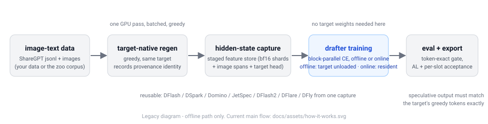

# vlm-dflash

**The simplest reproducible path to train a multimodal parallel drafter
(DFlash family) for Qwen-VL from image-text data — and to check it with a
token-exact gate.**



Text-only speculative-decoding stacks break on Qwen-VL's multimodal details:
processor pixel bounds, MRoPE position ids, image-token spans, the reserved
mask embedding row, tied vs untied `lm_head`. vlm-dflash pins that whole loop
once and lets five drafter algorithms (DFlash, DSpark, Domino, JetSpec,
DFlash2) train, evaluate and export through the same commands and the same
captured features. There is no new algorithm here and no serving framework —
the point is a correct, inspectable multimodal training loop.

Why this instead of patching SpecForge / NeMo AutoModel yourself:

- the multimodal data → regen → capture → train → eval → export chain runs
  end-to-end today for Qwen2.5-VL-3B (and Qwen3-VL-8B), with a five-minute
  demo and a one-command pipeline smoke;
- teacher/target mismatches fail loudly: the target contract (mask token,
  MRoPE, layer routing, pixel bounds, processor fingerprint) is resolved at
  runtime, recorded per stage, and every stage gate refuses silent reuse;
- every acceptance number in this README is backed by a recorded run that
  passed the token-exact gate (speculative greedy output must equal the
  target's greedy output token-for-token), not just a speedup figure.

## 1. Try a pretrained drafter (no training)

Frozen v0.3.0 exports for **Qwen2.5-VL-3B-Instruct** (token-exact validated,
see the [Model Zoo](#4-model-zoo)):

```bash
# download a released drafter (387 MB; time depends on your network)
curl -L -O https://github.com/LUOseu/vlm-dflash/releases/download/zoo-v0.3.0/qwen25vl-3b-dflash.tar.gz
tar xzf qwen25vl-3b-dflash.tar.gz

# run it (≈2 min on one A6000; needs a local Qwen2.5-VL-3B model checkout)
vlm-dflash demo --target <Qwen2.5-VL-3B-Instruct> --drafter qwen25vl-3b-dflash
```

`demo` builds a tiny license-free sample, prints the generated answers, checks
that the speculative output is token-identical to the target's greedy output,
and reports acceptance length (AL) and per-slot acceptance. Drop `--drafter` to
score a random-init drafter instead — that is the acceptance baseline, a useful
diagnostic (AL ≈ 1.00). AL is an acceptance metric, not a speedup; the
sequential verification path is the correctness-first path.

## 2. Train your own drafter

Requirements: one CUDA GPU (an A6000 48 GB is the reference; see
[limitations](#7-limitations)), a local Qwen2.5-VL-3B-Instruct checkout, and a
multimodal dataset (the smoke preset ships a COCO-caption path).

```bash
git clone https://github.com/LUOseu/vlm-dflash && cd vlm-dflash
python -m venv .venv && . .venv/bin/activate && pip install -e ".[tested]"

export VLM_DFLASH_TARGET=/path/to/Qwen2.5-VL-3B-Instruct
vlm-dflash doctor --target "$VLM_DFLASH_TARGET"      # environment + model contract
vlm-dflash train --preset smoke --limit 64          # data -> regen -> capture -> train
vlm-dflash eval runs/smoke_coco                     # token-exact gate + AL + per-slot
vlm-dflash export runs/smoke_coco                   # self-describing checkpoint + card
```

Until the package is on PyPI, installing from a clone (`pip install -e .`) is
the only supported install path. There is also a ~3-minute end-to-end demo
(measured on the reference card) that needs **no dataset download**:

```bash
vlm-dflash train-demo --target "$VLM_DFLASH_TARGET" --steps 80
```

It runs prepare → target-native regen → capture → tiny training → token-exact
eval → export on a generated sample and finishes with the trained checkpoint
scored against the random-init baseline.

The full long-answer recipe (512-row LLaVA-style subset, ~1 GPU-hour on an
A6000): `bash scripts/quickstart.sh --config configs/qwen2_5_vl_3b.yaml --limit 512`.
Every stage is also a standalone script (`scripts/prepare_data.py`,
`generate_target_data.py`, `capture_features.py`, `train_dflash.py`,
`eval_dflash.py`); `train` additionally supports `--resume` and
`--algorithm <name>`, and `--features <dir>` to train another algorithm from
an existing capture without re-running the target (see §5).

## 3. Supported algorithms and targets

| Algorithm | Qwen2.5-VL | Qwen3-VL | Maturity | Notes |
| --- | --- | --- | --- | --- |
| DFlash | validated | validated | stable | frozen reference; decayed block CE |
| DSpark | validated | reduced validation | validated | Markov logit bias + confidence head |
| Domino | validated | reduced validation | validated | causal GRU correction |
| JetSpec | validated | reduced validation | validated | forward-KL + causal in-block mask; tree runtime not ported |
| DFlash2 | validated | reduced validation | experimental | objective reconstruction (upstream undisclosed) |

The algorithms share one backbone and one pipeline; switching algorithms never
re-opens the multimodal plumbing (checkpoints record their algorithm and
`train` / `eval` / `export` fail loudly on mismatches). Target columns follow
[`SUPPORT_MATRIX.md`](SUPPORT_MATRIX.md) (generated from the same
machine-readable metadata that `vlm-dflash doctor --algorithm <name>` and the
exported model cards report): `validated` = canonical protocol recorded;
`reduced validation` = full pipeline recorded at reduced scale
(256-row slice / 16-prompt eval for Qwen3-VL, see
[`RELEASE_VALIDATION.md`](RELEASE_VALIDATION.md)).

Everything family-specific (mask token, MRoPE sections, draft-layer routing,
pixel bounds, tied vs untied `lm_head`) is resolved from the target at runtime
into a `contract.json` and validated against the config defaults. Single image
+ text, greedy decoding, one target per run.

## 4. Model Zoo

| Checkpoint | Algorithm | AL (2K protocol) | Download | Model card |
| --- | --- | ---: | --- | --- |
| `qwen25vl-3b-dflash` | DFlash (frozen reference) | 1.6298 | [387 MB](https://github.com/LUOseu/vlm-dflash/releases/download/zoo-v0.3.0/qwen25vl-3b-dflash.tar.gz) | [card](docs/zoo/qwen25vl-3b-dflash.md) |
| `qwen25vl-3b-domino` | Domino | 1.7637 | [464 MB](https://github.com/LUOseu/vlm-dflash/releases/download/zoo-v0.3.0/qwen25vl-3b-domino.tar.gz) | [card](docs/zoo/qwen25vl-3b-domino.md) |

Each archive contains `model.safetensors`, `draft_config.json`,
`algorithm.json`, `target_contract.json`, `training_manifest.json`,
`checksums.json` (sha256 per file) and a generated `model_card.md`. Both were
exported from the recorded runs and re-verified after download
(token-exact, 2026-10-13). The other four zoo checkpoints (DSpark, JetSpec,
DFlash2-exp, Qwen3-VL-8B DFlash) are reproducible with
`python scripts/export_zoo.py` from the recorded runs — they are not hosted
yet; don't wait on downloads that don't exist.

## 5. Train on your own data

`prepare_data` accepts a local JSONL pool (`dataset.source: jsonl`). Each row
is one image + one question/answer pair in any of three shapes — OpenAI
`messages`, ShareGPT/LLaVA `conversations`, or flat
`{question, answer, image}` keys; see
[`vlm_dflash/data/schema.py`](vlm_dflash/data/schema.py) for the exact
contract. Minimal example:

```json
{"id": "ex1", "question": "<image>\nDescribe this image in detail.", "answer": "…", "image": "000000.jpg"}
```

```bash
vlm-dflash train --config my_data.yaml --limit 2000      # or scripts/quickstart.sh
```

Reusing one capture across algorithms (the zoo protocol): point another
algorithm's run at an existing feature store instead of re-running the target:

```bash
vlm-dflash train --dataset data/rows.jsonl --target "$VLM_DFLASH_TARGET" \
    --algorithm dspark --run-dir runs/dspark_2k \
    --features runs/shared_2k/features --steps 792
```

The store's target identity, manifest and saved target head are verified
against the live contract before training, and the reuse (directory, sample
count, seq length, dtype, manifest digest) is recorded in the run's
`provenance.json`. One 2K capture is ≈9.4 GiB on disk and skips one
regen + capture (GPU-seconds and target forwards) per additional algorithm.

## 6. Benchmarks

All numbers: Qwen2.5-VL-3B-Instruct (unless noted), 2K-row corpus, block size
8, 128 eval prompts / 128 new tokens, greedy, **sequential verification —
token-exact for every row**, one RTX A6000. Frozen machine-readable results:
[`benchmarks/results/zoo_canonical.json`](benchmarks/results/zoo_canonical.json)
/ [`.csv`](benchmarks/results/zoo_canonical.csv)
(extracted from the recorded run artifacts by
[`scripts/extract_zoo_results.py`](scripts/extract_zoo_results.py); the full
tables and ablations live in [`BENCHMARKS.md`](BENCHMARKS.md)).

Acceptance / training behavior:

| Algorithm | AL | rand-init | token-exact | params | steps | block CE (first→last 10%) | peak VRAM | train wall | per-slot (1–7) |
| --- | ---: | ---: | --- | ---: | ---: | --- | ---: | ---: | --- |
| DFlash | 1.6298 | 1.003 | 128/128 | 243.8M | 792 | 7.50 → 3.79 | 29.5 GB | 9.8 min | .413 .149 .048 .015 .004 .001 0 |
| DSpark | 1.7354 | 1.003 | 128/128 | 321.6M | 792 | 7.59 → 3.45 | 38.1 GB | 11.8 min | .432 .173 .074 .034 .015 .007 .003 |
| Domino | 1.7637 | 1.003 | 128/128 | 292.9M | 792 | 7.25 → 2.20 | 38.4 GB | 12.9 min | .443 .180 .078 .036 .016 .009 .005 |
| JetSpec | 1.5987 | 1.003 | 128/128 | 243.8M | 792 | 6.06 → 3.26 | 29.7 GB | 20.6 min | .408 .137 .040 .011 .003 .001 0 |
| DFlash2 (exp. objective) | 1.9541 | 1.003 | 128/128 | 328.5M | 792 | 5.61 → 1.48 | 31.1 GB | 22.7 min | .495 .243 .118 .060 .027 .013 .006 |

(Qwen3-VL-8B DFlash for reference: AL 1.665, 32/32 token-exact, 1500 steps,
5.60 s/sample. Training uses one staged capture ≈9.4 GiB; training itself
never loads the target.)

Actual inference cost (what it takes to *run* them, sequential mode):

| Run | Mode | s/sample | vs target-only | Token-exact |
| --- | --- | ---: | ---: | --- |
| 3B DFlash (AL 1.63) | sequential | 4.14 | 0.87x | 128/128 |
| 3B DSpark | sequential | 4.10 | 0.86x | 128/128 |
| 3B Domino | sequential | 4.30 | 0.84x | 128/128 |
| 3B JetSpec (causal mask) | sequential | 4.07 | 0.86x | 128/128 |
| 3B DFlash2 | sequential | 4.43 | 0.82x | 128/128 |
| 8B DFlash (AL 1.67) | sequential | 5.60 | 0.81x | 32/32 |

The sequential path is **not a speedup** (0.8–0.9x on this card): it is the
correctness reference and the only token-exact path. Parallel / strict-parallel
modes reach ~1.0–1.25x but are not bitwise exact in bf16 and are reported as
experimental throughput only (see
[`docs/verification-modes.md`](docs/verification-modes.md)).

Public workload: TextVQA validation, 128-prompt seeded subset — DFlash
1.263 / DSpark 1.253 / Domino 1.268 AL, token-exact 128/128. This measures
**speculative acceptance and exactness on TextVQA prompts** (32-token budget),
not standard-answer accuracy of the model. Reproduce with
`scripts/prepare_benchmark.py` + `scripts/benchmark.py`
([`docs/benchmark.md`](docs/benchmark.md)).

Reproducibility: same-seed reruns reproduce data/regen protocols
(`rows_sha256` identical) but not bf16 bits; treat sub-2% AL differences as
noise. The frozen baseline re-evaluates bit-identically
(`tests/reference_dflash/manifest.json`).

## 7. Limitations

- Single image + text only; no video, no multi-image, no multi-turn.
- Two target families (Qwen2.5-VL-3B, Qwen3-VL-8B); other families need a
  small adapter (`vlm_dflash/adapters/`).
- No production serving integration — this repo trains, evaluates and exports
  drafters; the sequential verification path is correctness-first, not a speed
  path, and the serving bridge is a documented proposal, not a feature
  ([`docs/serving-bridge.md`](docs/serving-bridge.md)).
- Parallel / strict-parallel verification is **not bitwise exact** in bf16
  ([`docs/verification-modes.md`](docs/verification-modes.md)); always compare
  exactness first.
- DFlash2 trains with an experimental objective reconstruction (upstream
  objective undisclosed); JetSpec's production parallel-tree runtime is not
  ported.
- Hardware: one 48 GB card is the measured reference; 24 GB setups are a
  suggested, unvalidated target — lower `train.micro_batch_size` /
  `capture.seq_length` if you are memory-constrained.

## 8. Documentation

| Document | What it covers |
| --- | --- |
| [`docs/REFERENCE.md`](docs/REFERENCE.md) | ported training semantics, AL definition, head/MRoPE rules |
| [`docs/algorithms/<name>.md`](docs/algorithms/) | per-algorithm design, config, train/eval commands |
| [`docs/upstream/<name>.md`](docs/upstream/) | upstream audit: sources, commits, licenses, parity level |
| [`docs/benchmark.md`](docs/benchmark.md) | the benchmark harness + workload manifests |
| [`docs/verification-modes.md`](docs/verification-modes.md) | sequential vs parallel verification, runtime probe |
| [`docs/measured-runs.md`](docs/measured-runs.md) | end-to-end measured runs and scaling tables |
| [`docs/adding_an_algorithm.md`](docs/adding_an_algorithm.md) | what a new drafter plugin must implement |
| [`BENCHMARKS.md`](BENCHMARKS.md) / [`STATE.md`](STATE.md) | every measured number / current project state |
| [`RELEASE_VALIDATION.md`](RELEASE_VALIDATION.md) | the release validation record for this version |

Small Python API examples live in [`examples/`](examples/).

## License

Apache-2.0. Ported/adapted components carry their upstream attribution in
[`NOTICE`](NOTICE); each algorithm's parity level and license are recorded in
[`UPSTREAM_AUDIT.md`](UPSTREAM_AUDIT.md) and [`docs/upstream/`](docs/upstream/).
