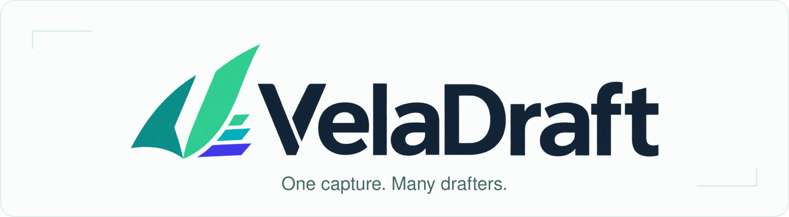
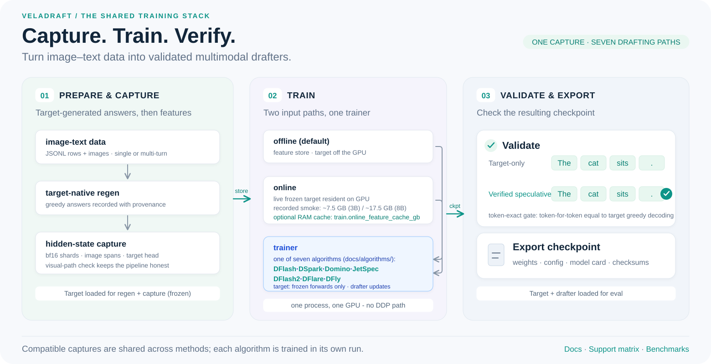

<p align="center">
  
</p>

<p align="center">
  <strong>Train and benchmark multimodal speculative drafters in one workflow.</strong><br />
  VelaDraft shares data preparation, frozen-target features, training, evaluation,
  and export across drafter families, with a particular focus on parallel
  block-diffusion drafters such as DFlash and DSpark.
</p>

<p align="center">
  <sub>Primary verified targets: Qwen2.5-VL-3B and Qwen3-VL-8B &mdash; verification scope differs
  by method, recipe and run mode; SmolVLM2 so far has a DFlash single-image smoke.
  See the <a href="SUPPORT_MATRIX.md">support matrix</a>.</sub>
</p>

<p align="center">
  <a href="https://github.com/LUOseu/VelaDraft/actions/workflows/ci.yml"></a>
  <a href="https://github.com/LUOseu/VelaDraft/blob/main/pyproject.toml"></a>
  <a href="https://github.com/LUOseu/VelaDraft/blob/main/LICENSE"></a>
</p>

<p align="center">
  <a href="#quick-start">Quick Start</a> ·
  <a href="docs/model-zoo.md">Model Zoo</a> ·
  <a href="BENCHMARKS.md">Benchmarks</a> ·
  <a href="docs/README.md">Docs</a> ·
  <a href="SUPPORT_MATRIX.md">Support Matrix</a> ·
  <a href="CONTRIBUTING.md">Contributing</a>
</p>

<p align="center">
  <a href="README.md">English</a> · <a href="README.zh-CN.md">简体中文</a>
</p>

---

## 🎉 News

- **[2026-10-18]** 🔥 Added the **Qwen3.6-35B-A3B target adapter** with partial
  rotary support for regeneration, feature capture and dense drafter training
  ([#18](https://github.com/LUOseu/VelaDraft/pull/18), thanks to
  [@khazic](https://github.com/khazic)). Implemented and CPU-tested; end-to-end
  training validation is pending, and speculative decoding is blocked on
  hybrid-cache rollback. See the [support matrix](SUPPORT_MATRIX.md#targets).

## Why VelaDraft

`VelaDraft` is the project; the package and CLI are still called `vlm-dflash`.

- **Reuse expensive target work.** One compatible offline capture serves
  several drafter methods; online training can keep extracted records in an
  optional host-RAM cache instead of paying the same target forward every epoch.
- **Compare methods in one workflow.** From your own image-text data, training,
  acceptance-length evaluation and export go through the same shared commands,
  and every recorded result carries its config and protocol.
- **Keep checkable training artifacts.** Checkpoint, target identity, training
  records and evaluation results stay together for resume, reproduction and
  further tooling.

<p align="center">
  
</p>

"Unified" means shared interfaces and protocol records &mdash; not identical
objectives, budgets or maturity across algorithms.

## Supported methods

Seven drafter families share one `train` / `eval` / `export` CLI, one
checkpoint format and one token-exact verification path:

| Method | Idea | Status |
|---|---|---|
| [DFlash](docs/algorithms/dflash.md) | Block-parallel drafting | Validated |
| [DSpark](docs/algorithms/dspark.md) | Markov correction + confidence | Validated |
| [Domino](docs/algorithms/domino.md) | Causal GRU correction | Validated |
| [JetSpec](docs/algorithms/jetspec.md) | Causal block attention + forward KL | Validated with sequential serving (the parallel tree runtime is not ported) |
| [DFlash2](docs/algorithms/dflash2.md) | Local mixing + candidate selector | Experimental objective reconstruction (upstream objective undisclosed) |
| [DFlare](docs/algorithms/dflare.md) | Layer-wise target fusion | Validated |
| [DFly](docs/algorithms/dfly.md) | Fusion residual + hidden correction | Validated, including the ported upstream two-stage recipe |

Recipe selection (default objective, optional recipe, required teacher signal,
released weights) is one table in
[docs/README.md](docs/README.md#choose-a-method--recipe); per-target evidence
states live in [SUPPORT_MATRIX.md](SUPPORT_MATRIX.md) (generated).

Scope and limits:

- **Input:** images (one or many) + text, single- or multi-turn, greedy
  decoding. Default multi-turn supervision is `last_turn_only`: earlier
  assistant turns are teacher-forced context, only the last one is regenerated
  and supervised ([docs/data.md](docs/data.md)).
- **Hardware:** the validated reference is a single 48 GB GPU; the 24 GB preset
  remains a *suggested* configuration (no recorded run on a real 24 GB card).
- **Training modes:** offline staged features (default), online live
  extraction from a frozen target, and `--features` store reuse. There is no
  DDP / multi-node launch path. "Online" is not on-policy rollout training.
- **Qwen3.6-35B-A3B:** the `qwen3_5_moe` adapter is implemented and CPU-tested;
  the method validation statuses above do not establish validation on this
  target. Set `drafter.intermediate_size` explicitly for the dense drafter.
  [Sharded target loading](docs/online-training.md#devices-what-is-supported-today) and
  [chat-template kwargs](docs/REFERENCE.md#chat-template-kwargs-render-protocol)
  are also available, including `enable_thinking: false`. End-to-end training
  remains unvalidated; speculative `eval` / `benchmark` / `spec_generate`
  are explicitly blocked until hybrid recurrent-cache rollback is implemented.
- **Serving:** production vLLM/SGLang integration is future work;
  [serving-bridge.md](docs/serving-bridge.md) is an experimental export/load
  tool whose correctness and performance gates are not closed.
- **Reproducibility:** data and generation protocols reproduce; bf16 training
  is not bitwise-deterministic.

## Start here

| Path | What it gives you |
|---|---|
| **[Run the full pipeline](docs/getting-started.md)** | install, prepare a local target, `doctor`, a first demo, then `train` on your own data |
| **[Try a released drafter](docs/model-zoo.md)** | a pretrained checkpoint now &mdash; `demo --drafter` reports acceptance length, per-slot acceptance and token-exactness with no training |

```bash
curl -fL -O https://github.com/LUOseu/VelaDraft/releases/download/zoo-v0.3.0/qwen25vl-3b-dflash.tar.gz
tar -xzf qwen25vl-3b-dflash.tar.gz
vlm-dflash demo --target "$VLM_DFLASH_TARGET" --drafter qwen25vl-3b-dflash
```

Recorded on the reference host: 42 s, AL 1.313, 4/4 token-exact (the
random-init baseline demo: 45 s, AL 1.000). Both DFly variants are published
&mdash; the shared-CE default and the ported upstream recipe:

| Drafter | Target | Download |
|---|---|---|
| DFlash | Qwen2.5-VL-3B | [387 MB `zoo-v0.3.0`](https://github.com/LUOseu/VelaDraft/releases/download/zoo-v0.3.0/qwen25vl-3b-dflash.tar.gz) |
| DFly (shared block CE) | Qwen2.5-VL-3B | [420 MB `zoo-v0.3.1`](https://github.com/LUOseu/VelaDraft/releases/download/zoo-v0.3.1/qwen25vl-3b-dfly.tar.gz) |
| DFly (upstream two-stage recipe, AL 1.839) | Qwen2.5-VL-3B | [420 MB `zoo-v0.3.2`](https://github.com/LUOseu/VelaDraft/releases/download/zoo-v0.3.2/qwen25vl-3b-dfly-recipe.tar.gz) |
| DFlash | Qwen3-VL-8B | [1.00 GB `zoo-v0.3.1`](https://github.com/LUOseu/VelaDraft/releases/download/zoo-v0.3.1/qwen3vl-8b-dflash.tar.gz) |

All nine archives (Domino, DSpark, JetSpec, DFlash2 and DFlare included),
their checks and load commands: [docs/model-zoo.md](docs/model-zoo.md).

## Quick start

```bash
git clone https://github.com/LUOseu/VelaDraft.git
cd VelaDraft

python -m venv .venv
source .venv/bin/activate
pip install -e ".[tested]"        # source install; there is no PyPI release yet

# Prepare the target once (configs run local_files_only and never download it).
export VLM_DFLASH_TARGET="$PWD/assets/models/Qwen2.5-VL-3B-Instruct"
hf download Qwen/Qwen2.5-VL-3B-Instruct --local-dir "$VLM_DFLASH_TARGET"
# restricted network: prefix the same command with HF_ENDPOINT=https://hf-mirror.com

vlm-dflash doctor --target "$VLM_DFLASH_TARGET"
# success: exit 0, [ok] lines, and a resolved contract line
# (mask=151669 mrope=[16,24,24] layers=[1,17,33] ...)

vlm-dflash train-demo --target "$VLM_DFLASH_TARGET" --steps 80
```

`train-demo` runs the whole staged pipeline (prepare → target-native regen →
capture → train → eval → export) on generated images. Recorded on the reference
host (single RTX A6000 48 GB, historical): 3 min 13 s, loss 13.0 → 0.013, eval
AL 1.138 vs random-init 1.000, 4/4 token-exact, export under
`runs/demo_dflash/export/`. It is a plumbing smoke, not a quality result.

Longer runs, logs, stop conditions, resume and hardware details:
[docs/getting-started.md](docs/getting-started.md) ·
[docs/training.md](docs/training.md).

## Three things you can do today

**1. Train on your own image-text data.** One JSON object per line; `image` is
resolved against `--images-dir`:

```jsonl
{"id":"row-001","image":"cat.jpg","question":"What is in this image?","answer":"A cat sleeps on a sofa."}
```

```bash
python examples/train_from_jsonl.py \
  --target "$VLM_DFLASH_TARGET" \
  --jsonl data/rows.jsonl --images-dir data/images \
  --limit 32 --steps 60
```

Runs prepare → regen → capture → train → eval and leaves checkpoints plus an
export in the run directory. Recorded (12 COCO rows, 10 steps): loss 7.69 →
7.06, visual check passed, token-exact 4/4. `--limit` is the number of
**training** rows &mdash; validation rows are drawn on top. Row shapes, split
rules and multi-turn supervision: [docs/data.md](docs/data.md).

**2. One capture, compare several drafters.** Regen + capture run once (the
expensive target work); each drafter then trains from the same store with the
target out of the loop:

```bash
python examples/reuse_features_compare.py \
  --target "$VLM_DFLASH_TARGET" \
  --jsonl data/rows.jsonl --images-dir data/images --steps 20
```

Recorded (12-row COCO pool, 5 steps, smoke scale): DFlash AL 1.153 / DSpark
AL 1.094, both token-exact. Reuse is verified, not assumed &mdash; the store's
target identity and the layers a method consumes must match, and mismatches
fail loudly ([docs/training.md](docs/training.md)). The CLI form is
`vlm-dflash train --features <store>`.

**3. Pick a training mode by resources.** Offline reads a staged feature store
(target off the GPU; ~9.4 GiB disk for the 2K capture); online keeps the frozen
target resident and extracts live; a multi-epoch online run can opt into a
host-RAM record cache (never persisted):

```bash
# offline (default)
vlm-dflash train --config configs/dfly/qwen2_5_vl_3b_2k.yaml --run-dir runs/dfly_2k

# online, with the optional RAM cache
vlm-dflash train --config configs/dfly/qwen2_5_vl_3b_2k.yaml --mode online \
  --run-dir runs/dfly_online --set train.online_feature_cache_gb=8
```

Recorded cache counters (129 rows / 6 epochs): 645 hits / 129 misses /
129 stores / 0 evictions, peak 830 MiB against the 8 GiB cap, reported in
`train_summary.json` → `feature_source.feature_cache`. Hits return stored
tensors bitwise; the cache stays outside the feature and plan digests, and its
training-time caveats are documented in
[docs/online-training.md](docs/online-training.md).

A multi-epoch run whose working set exceeds the cache budget can pin a static
retention plan instead of thrashing under plain LRU:
`--set train.online_feature_cache_policy=pinned` freezes a smallest-first plan
after the first training epoch and reuses those records across the remaining
epochs (details and counters in the pinned section of
[docs/online-training.md](docs/online-training.md)). Production CLI A/B
(512-row subset, 3 epochs, 2 pairs per cap): paired wall **-3.6% / -6.9%** at
0.8 / 1.6 GiB caps; the harness replay upper bound is -7.6% / -13.0% and
steady state converges to it.

## Results and evidence

Everything measured &mdash; acceptance length, per-slot acceptance, token-exact
gates, training costs, ablations, runtime probes &mdash; is recorded with its
protocol in [BENCHMARKS.md](BENCHMARKS.md) ·
[RELEASE_VALIDATION.md](RELEASE_VALIDATION.md) ·
[docs/measured-runs.md](docs/measured-runs.md). Machine-readable subset:
`benchmarks/results/zoo_canonical.json`.

What the numbers mean, precisely:

- **AL** is accepted tokens per target verification round &mdash; it is not a
  speedup multiplier. **Token-exact** means the speculative output reproduces
  the target's own greedy decoding; it is an output-consistency gate, not task
  accuracy. Task scores against ground truth (TextVQA/DocVQA/ChartQA answer
  accuracy) are **not reported yet**.
- The canonical benchmark runs are the **offline** path; online smokes validate
  plumbing (token-exactness, provenance, counters), not quality.
- Coverage is explicit: [SUPPORT_MATRIX.md](SUPPORT_MATRIX.md) states what is
  canonical-validated, reduced, smoke-only or unsupported per method × target ×
  mode, each row traced to recorded run ids.

## Documentation

[docs/README.md](docs/README.md) is the task index: install and first run, own
data, method/recipe selection, long training, online mode, evaluation and
troubleshooting. Direct links: [model-zoo.md](docs/model-zoo.md) ·
[data.md](docs/data.md) · [training.md](docs/training.md) ·
[online-training.md](docs/online-training.md) ·
[troubleshooting.md](docs/troubleshooting.md) ·
[algorithms/](docs/algorithms/) · [benchmark.md](docs/benchmark.md) ·
[env-preflight.md](docs/env-preflight.md) (historical host notes) ·
[REFERENCE.md](docs/REFERENCE.md) (implementation and numerical semantics).

## Contributing and citation

Reproductions, focused fixes and clear usage examples are welcome; the current
scope and release policy are in [CONTRIBUTING.md](CONTRIBUTING.md) and
[ROADMAP.md](ROADMAP.md). Algorithms plug in through `DrafterAlgorithm`, target
families through `VLMAdapter`.

Apache-2.0; ported components keep their upstream attribution
([NOTICE](NOTICE), [UPSTREAM_AUDIT.md](UPSTREAM_AUDIT.md)).

```bibtex
@misc{veladraft2026,
  title = {VelaDraft: Multimodal Speculative Drafter Training},
  year  = {2026},
  url   = {https://github.com/LUOseu/VelaDraft}
}
```

---

<p align="center">
  <sub><strong>Why “Vela”?</strong> Vela means sail &mdash; and names the constellation.
  A lightweight drafter rides the visual context the target model provides.</sub>
</p>
