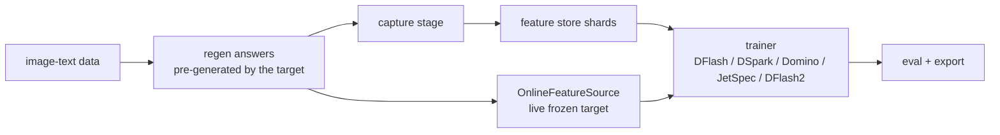

# Online training: live target feature extraction

`train.feature_mode=online` runs the frozen target VLM in the trainer process
and extracts teacher-forced hidden states **live during training**, instead of
reading a pre-captured feature store. The regenerated answers are still
pre-generated: this is not on-policy rollout generation, not continual
learning from live traffic, and not a serving runtime.

```bash
vlm-dflash train --mode online --config configs/qwen2_5_vl_3b.yaml \
  --run-dir runs/qwen25_online
```

`offline` stays the default (presets pin it). `--mode` and `--feature-mode`
are CLI aliases for `train.feature_mode`; the two modes are mutually exclusive
with `--features`.

## Configuration at a glance

All knobs live under `train.`. In every setup below the target does **frozen
forward passes only**; the drafter is what updates its parameters. And "no
feature store on disk" does not mean "no disk": a run still writes data,
regen, checkpoints, logs and eval output - online only removes the multi-GiB
`features/` store.

| Setup | Config | Default | What it does | Extra resources | Recorded evidence |
| --- | --- | --- | --- | --- | --- |
| Online, per-sample | `--mode online` | offline (presets pin it) | extracts live features instead of reading a store | frozen target resident on GPU for the whole run | GPU smokes: train -> token-exact eval -> export (3B, 8B untied, split devices) |
| Batched capture | `train.online_batch_size: N` | `1` (per-sample) | one padded target forward per N rows | may move the teacher batch composition (bf16 ulp scale) | 3-row smoke + a 16-row slice: 16 -> 4 forward calls, step losses bit-identical; extraction-wall re-measured under a unified boundary (pending, see below) |
| RAM record cache | `train.online_feature_cache_gb: <GiB>` | `0` (off) | serves repeat epochs from a byte-bounded host-RAM store | up to the configured GiB of host RAM; never persisted | 129 rows / 6 epochs: 645 hits / 129 misses / 129 stores / 0 evictions, peak 830 MiB; trajectory caveat below |
| Adaptive budget | `train.online_feature_cache_adaptive: true` | `false` | shrinks/grows the cache payload with the job's memory headroom | requires the RAM cache; eviction becomes dynamic | measured on the lane's slices; state under `feature_source.feature_cache.adaptive_budget` |

Enabling them is one flag each, e.g.
`--set train.online_batch_size=4` or
`--set train.online_feature_cache_gb=8` (see the commands below). Runtime
counters land in `train_summary.json` under `feature_source`:
`target_forwards_total` / `target_samples_total` for extraction, and
`feature_source.feature_cache` (capacity, hits, misses, stores, evictions,
retained/peak bytes) for the cache. The sections below document each setup,
its constraints and its numerical caveats.

## Offline vs online

| | offline (default) | online |
| --- | --- | --- |
| Target during training | not loaded | resident for the whole run |
| Feature store on disk | `features/shard_*.pt` + index (2K corpus ≈ 9.4 GiB) | none written |
| Target forward cost | capture stage, once per store | every epoch, per training row |
| Batched capture forward | n/a | opt-in via `train.online_batch_size` (default 1 = per-sample) |
| `capture` stage | runs | skipped (config still parsed + validated) |
| `train.num_workers` | any | must be 0 |
| Share a capture across algorithms | yes (`--features`) | no |
| Reuse across runs | store is portable and reusable | one target, one process; no multi-node launch path |
| Visual-path check | on captured features (`features/visual_path_check.json`) | on the live model (`online/visual_path_check.json`) |

Use **online** when you want a single-command train without managing a feature
store, when disk or IO for a multi-GiB store is the bottleneck, or when the
target should provably be the model the trainer holds. Use **offline** when
several algorithms share one capture, when the target is expensive relative to
the drafter (the cost is paid once, not per epoch), or when you need DataLoader
workers or a portable feature store. Neither mode ships a distributed
(DDP/multi-node) launch path: a store can be copied to another host, but
multi-node training is not a supported configuration of this repo today.

## Devices: what is supported today

| Layout | Status | Notes |
| --- | --- | --- |
| One process, target + drafter on the same GPU | validated path | The canonical protocol and all quality numbers train this way (offline); online smokes use the same layout. |
| One process, target / drafter on two GPUs | recorded smoke | `--set target.device=cuda:1 --set train.device=cuda:0` (GPU smoke 6 in *Validation status*). This is co-location, not DDP or tensor parallel: there is no gradient sync and no automatic producer/consumer overlap between the two devices — both live in the training loop's forward path. |
| Distributed (DDP / tensor parallel / multi-node) | not supported | No launcher or sync path exists in the trainer. Do not plan a multi-node job around this CLI. |

Device indices are logical: they refer to the process's visible devices after
`CUDA_VISIBLE_DEVICES`. With `CUDA_VISIBLE_DEVICES=2,3`, `cuda:0` in the config
is physical GPU 2 and `cuda:1` is physical GPU 3; without the mask, `cuda:1` is
physical GPU 1. Memory requirements depend on target, recipe, micro-batch,
sequence length and whether the overfit sanity runs: the 24 GB preset stays a
*suggested* configuration (no recorded run on a real 24 GB card), and the
DFlash demo peak is not a lower bound for every algorithm.

Measured smoke costs on one A6000 (3-row demo slice, 4 steps, batch 1 —
plumbing checks, not benchmarks):

| Target | Target resident | Train peak | Extraction |
| --- | ---: | ---: | ---: |
| Qwen2.5-VL-3B | 7.5 GB | 13.65 GB | 1 forward / 0.30 s (after resume fast-forward) |
| Qwen3-VL-8B (untied head) | 17.5 GB | 33.92 GB | 4 forwards / 2.87 s |

## What is shared with the offline path

The two paths differ only in where the per-sample records come from. (The
README pipeline image, `docs/assets/how-it-works.svg`, draws the offline
staged path; the diagram below adds the live source.)



- `vlm_dflash/target/sample_capture.py` is the shared per-sample capture used
  by both the staged capture stage and the online source: same record fields
  and dtypes (`input_ids`, `hidden`, `loss_mask`, `position3`, `image_span`,
  `sample_id`, optional `final_hidden`), same frozen-head resolution, same
  MRoPE / multimodal-token-type handling.
- The collator, training loop, loss, checkpointing, gradient-coverage audit,
  overfit sanity and calibration phases are the same code for both modes.
- The online source refuses an unfrozen or non-`eval()` target, and resolves
  the same teacher head as the capture stage (`target_lm_head` for untied
  targets, the embedding for tied ones).
- Provenance: `train_summary.json` gains `feature_mode` and a
  `feature_source` block; checkpoints record `feature_mode`,
  `feature_source_digest`, `feature_backend` and both devices;
  `provenance.json` carries the online source record; `eval` records
  `checkpoint_feature_modes`; `export` records `feature_mode`.

## Commands

Single-GPU smoke (small slice, short run):

```bash
vlm-dflash train --mode online --config configs/qwen2_5_vl_3b.yaml \
  --run-dir runs/qwen25_online_smoke --limit 8 --steps 4 \
  --set train.micro_batch_size=1 --set train.grad_accumulation_steps=1 \
  --set train.overfit_sanity.enabled=false
vlm-dflash eval runs/qwen25_online_smoke --num-prompts 4 --max-new-tokens 32
vlm-dflash export runs/qwen25_online_smoke
```

Like the other configs, these commands need prepared inputs: a **local target
checkout** (`--target` / `TARGET.model`), and a single-image JSONL pool with a
100%-valid image dir (`--dataset` / `--images-dir`); see the README *Train on
your data* section and `docs/env-preflight.md`.

Split devices (target on `cuda:1`, drafter on `cuda:0`):

```bash
vlm-dflash train --mode online --config configs/qwen3_vl_8b.yaml \
  --run-dir runs/qwen3vl8b_online \
  --set target.device=cuda:1 --set train.device=cuda:0
```

Resume after an interruption:

```bash
vlm-dflash train --mode online --config configs/qwen2_5_vl_3b.yaml \
  --run-dir runs/qwen25_online --resume
```

A resumed online run fast-forwards already-consumed batches with cheap
placeholders — those rows are **not** re-extracted; the new forward passes are
counted and `train_summary.json` records `resume_fast_forward_batches` and
`resume_fast_forward_reduced_cost`.

## Batched capture (`train.online_batch_size`)

By default (`train.online_batch_size: 1`) the online source runs one target
forward per training row; this stays the reference path. Setting
`train.online_batch_size: N` (`N > 1`) renders the rows per sample, runs
**one padded target forward per N rows** (a training micro-batch larger than
`N` is split into consecutive capture groups, so the effective group size is
`min(online_batch_size, micro_batch_size)`) and slices each row's record back
out of the batch: padding never reaches a record (`input_ids` / `hidden` /
`loss_mask` / `position3` keep the row's own length; multi-turn rows keep
their `image_spans`), and multi-image rows concatenate their pixel values /
grids exactly as one forward per row would.

With batching on, the trainer swaps its `DataLoader` for an internal iterator
that walks the same `RandomSampler` + `BatchSampler` sequence with the same
seeded generator, so batch composition is identical to the per-sample path
for a given seed, the dataset does not write a feature store, and exact
resume (including the placeholder fast-forward) is unaffected.

- CPU tests pin batched-vs-per-sample record equality on a real tiny
  Qwen2.5-VL target (single-image row + schema-v2 two-image / two-turn row,
  `capture.store_final_hidden` on) and the DataLoader order equivalence
  across epochs.
- A batch size > 1 is folded into the online source digest: an exact resume
  cannot silently switch grouping. Sharing one padded forward can move an
  attention reduction by an ulp, so a resumed run must keep its batch size.
- Counters: `target_forwards_total` counts model forward calls,
  `target_samples_total` counts extracted rows (they differ only when
  `online_batch_size > 1`). Fast-forward placeholders stay per-item and never
  consume target work.
- Measured on the registered WP2 smoke slice (`R-20261014-12`,
  `docs/plan/WP4_MEASUREMENT.md`): 16 synthetic 2-image / 2-turn rows,
  seq 1024, 4 steps, batch 1 vs capture group 4 - one forward per 4 rows
  instead of 16 forwards, target peak unchanged (13.67 GB), step losses
  bit-identical. The report's original extraction-wall percentage
  (2.84 s -> 2.31 s, "-18.8%") is **superseded/invalid** (R2: the per-sample
  leg timed render+forward, the batched leg only forward); the unified
  boundary is implemented in `vlm_dflash/target/online.py`, and quoting an
  extraction-wall gain waits for the paired GPU re-measurement. Prefill
  compute dominates on that slice (profiling: render ~17 ms vs forward
  129-139 ms/row).

## Host-RAM record cache (`train.online_feature_cache_gb`, opt-in)

With a frozen target and pre-generated regen answers, a row's extracted record
is epoch-invariant when the extraction grouping is unchanged: re-extracting it
in a later epoch with the same grouping reproduces the same bytes (measured
2026-10-14: fixed-order runs are bit-identical end to end).
`train.online_feature_cache_gb: <GiB>` (default `0` = disabled) keeps
extracted records in a byte-bounded host-RAM store inside the online source,
so later reads of the same row are served from RAM instead of re-running the
target. The store is LRU-evicted at the byte cap and never persisted; the
train / overfit-sanity / calibration phases share it; a record larger than the
whole cap is not retained (it would evict every other entry for one hit).

The cache does not change which rows are consumed or their order, and hits
return the stored tensors bitwise. A miss (cold start, eviction, or a cap
below the working set) re-extracts through the reference extraction path;
with `online_batch_size > 1` a partially cached capture group forwards only
its missing rows, so eviction does not guarantee byte-identity with a
cache-off run — the same grouping sensitivity documented for batching above
(a cold start still forwards the full group). It stays out of the feature
digest and the training-plan digest. A resume — exact or not — starts from a
cold cache and re-extracts; it is functionally resumable, but under a shuffling loader
it is not guaranteed bit-exact to an uninterrupted cached run, because
post-resume re-extraction uses the resumed epoch's batch grouping instead of
the original epoch-1 grouping the uninterrupted run's cache held (drift stays
in the same bf16-rounding class as the caveat below).
`train_summary.json` reports it under `feature_source.feature_cache`
(capacity, hits, misses, stores, evictions, retained/peak bytes). Use it on
multi-epoch online runs when host RAM can hold the record set (the lane's
1012-row 2K slice retained 6.4 GiB — as an offline store the same rows take
7.0G on disk) — it removes the per-epoch re-extraction for every row that
fits. In the lane's paired offline baseline (2026-10-14), training from the
already-written store took 548.8 s vs this cache's 470.9 s train stage, with
zero disk bytes.

`train.online_feature_cache_adaptive: true` (default `false`) additionally
bounds the retained payload by the job's own memory headroom (the process
cgroup's tightest limit, combined with `MemAvailable`, minus a reserve): the
byte budget shrinks immediately under pressure (early LRU evictions; later
reads re-extract as usual) and grows back stepwise when headroom returns. It
preserves the logical sample order and the training objective, but dynamic
eviction changes which rows are missing from the next capture group, so the
teacher forward's batch composition — and with it the padding numerics — can
differ from an uncached or uninterrupted run: dynamic eviction does not
guarantee a bit-exact numerical trajectory (the same grouping sensitivity the
paragraph above documents). With the flag off the cache behaves exactly as
above. Enabled runs report the extra state under
`feature_source.feature_cache.adaptive_budget` (cap / job share / current
budget, reserve, retained bytes, shrink / grow counts, sensor snapshot); like
the cache itself it is runtime-only and outside every digest.

Caveat (measured on the lane's 129-row and 2K-row slices, 2026-10-14): the
default shuffled loader draws a different row order every epoch, so the
per-epoch grouping — and with it the batched teacher forward's padding
numerics — changes, and a cached run drifts from a re-extracting run at the
bf16-rounding scale from the first hit onward (deterministic; OFF/OFF and
ON/ON runs are each bit-identical). Measured: 129 rows / 6 epochs → max
|delta| 2⁻⁷ in weights, loss identical 102/102; 2K rows / 6 epochs / 762
steps → max |delta| 0.0446, global relative-L2 4.26%, loss identical 740/762
(rest ≤ 2 display ulp), valid_tokens identical throughout. The downstream
acceptance eval (128 prompts) is functionally identical (mean acceptance
length equal to 10 decimals; token-exact both ways), and a seed-change
control puts the weight drift 30–90× below the pipeline's own run-to-run
variation. A fixed epoch order restores full bit-identity (end-to-end
`ckpt_final.pt` sha256 match) — measured with a lane-only diagnostic patch
that pins the loader order (not part of this change). The cache itself is
value-exact either way: hits return the stored tensors bitwise. See
`research/system_optimization/REPORT.md` §4.3-§4.6.

## Exact resume

An "exact" resume means: same mode, algorithm, feature source, identity and
training plan as the uninterrupted run. Four gates enforce that, all
read-only until every check passes:

1. **Read-only preflight.** `train --resume` validates before writing
   anything. A refused resume leaves `config.json`, `ckpt_init.pt` /
   `ckpt_last.pt` / `ckpt_final.pt`, logs, `provenance.json` and the visual
   diagnostics byte-identical; a legal resume keeps the original
   `ckpt_init.pt` (the random-init baseline is never regenerated). The CLI
   preflight also refuses `--resume --force` (force rebuilds upstream stages,
   which exact resume must not do) and refuses a run whose upstream stages
   would have to be rebuilt. It does not load the target: the online digest
   is derived from the consumed rows and image bytes directly.
2. **Versioned content digest.** `feature_source_digest` is
   `vlm-dflash-online-source-digest-v2`: the prompt/answer token ids of every
   consumed row in order (the exact `--limit` slice), the image bytes
   (hashed from the files and verified against `data/manifest.json` — a stale
   manifest is a loud error, never evidence), the extraction settings
   (seq length, storage dtype, `store_final_hidden`, routed layers, target
   dtype/attention) and the contract identity (absolute paths excluded). A
   same-length token edit or a same-size image swap changes the digest; the
   same content copied to another directory does not. Offline stores use the
   equivalent `offline_feature_digest` over manifest + index + shard + head
   bytes.
3. **Training-plan digest.** `vlm_dflash/training_plan.py` records a versioned
   digest of the effective, resolved plan in every checkpoint: seed,
   micro-batch, accumulation, epochs, dataset length (data order), draft
   dtype, optimizer and schedule settings, drafter architecture knobs and the
   algorithm-namespaced knobs with defaults filled in. Changing any of them —
   including shape-compatible ones like the shuffle seed or a loss weight —
   refuses the resume; device, logging cadence, worker count and checkpoint
   cadence are deliberately excluded.
4. **Committed-progress log reconciliation.** Before the replay appends
   anything, `train_log.jsonl` is trimmed back to the checkpoint's committed
   `step` (recorded in `ckpt_last.pt`). Rows past it — including a
   half-written final line from an interrupted write — are preserved as
   `train_log.uncommitted.jsonl` (a recovery artifact), so a resumed run
   keeps unique, ordered log steps instead of duplicating the replay tail
   (`[1,2,3]` resumed at step 2 ends `[1,2,3,4,...]`, not `[1,2,3,3,...]`).
   A run that completes writes its final resumable state to `ckpt_last.pt`
   (`step == total_steps`), so an exact resume of a finished run replays
   zero steps and leaves the log untouched.

Migration policy: checkpoints written before these gates (no recorded plan
version/digest) are **not** exactly resumable — the extra information cannot
be reconstructed, and the run refuses instead of re-stamping old checkpoints
with new digests. Start a new run directory, or retrain. The same applies to
a checkpoint recorded under an older digest scheme: the version tag is
compared first and a mismatch is refused rather than compared across schemes.

## Config requirements

The online source reads the same `capture:` section as the capture stage, so
per-algorithm capture requirements apply unchanged:

- all algorithms: `capture.seq_length`, `capture.dtype` (storage dtype);
- JetSpec: `capture.store_final_hidden: true` **and**
  `drafter.loss_decay_gamma: null`;
- DFlash2: `capture.store_final_hidden: true`.

`doctor` / `validate_config` applies the same fail-loud checks in both modes.
CLI `--set` overrides are merged **before** validation runs, so a required
knob can be supplied either in the YAML or on the command line (e.g. the
JetSpec flags above).

## Boundaries and failure behavior

- `--features <store>` + `--mode online` is refused before any stage runs.
- `train.num_workers` must be 0: the target cannot be copied into a worker.
  Enforced at the CLI level and by the dataset's main-process guard.
- A leftover `features/` store in the same run directory is ignored with a log
  note (run with `--mode offline` to use it).
- `regen/target_data.jsonl` is still required — regen remains the supervision.
- Resume refuses a mode / algorithm / feature-source-digest / training-plan /
  step-plan / identity mismatch (see *Exact resume*). Checkpoints written
  before the feature-mode tag (no `feature_mode`) are read as offline.
- Resume follows the run's real dependency chain: `--features` resumes check
  the data stage plus store digest / plan / identity and never demand
  `regen`/`capture` outputs an external-store run never produced; online and
  internal-offline resumes additionally require regen (and capture for
  offline). A refused resume still leaves every original file byte-identical.
- Resource cleanup covers startup: any failure after the target became
  resident — source init, manifest access, the startup visual check, trainer
  build, training or calibration — closes the source (idempotent;
  partially-constructed instances are closed by the constructor itself) and
  drops the model/processor/embed/head references, then re-raises the
  original error unchanged.
- The shared loop's stall guard counts valid micro-batches (successful
  forward + backward), not optimizer steps: with a small dataset and a large
  accumulation window one optimizer step may legitimately span several
  epochs. Three consecutive epochs with zero valid supervision (every batch
  raising `NoValidAnchorsError`) still stop the run.
- Dtypes: the frozen embed/head handed to the trainer is stored in
  `capture.dtype` (offline) / the storage dtype (online) and must equal
  `train.draft_dtype`. The supported storage dtype today is `bfloat16`
  (`capture.dtype: float16` is refused before training); the target itself
  keeps its own compute dtype (`target.dtype`) and is never modified.
  `train_summary.json` records the effective combination in its `dtypes`
  block.
- `eval` loads the target for verification either way.

## Extraction cost accounting

`train_summary.json` records what the live extraction cost, per phase:

```json
"feature_source": {
  "backend": "huggingface",
  "digest_version": "vlm-dflash-online-source-digest-v2",
  "online_batch_size": 1,
  "target_resident_bytes": 7507746816,
  "extractions": {"train": {"target_forwards": 4, "target_samples": 4, "wall_seconds": 2.87,
                            "target_device_peak_gb": 13.1}},
  "target_forwards_total": 4,
  "target_samples_total": 4,
  "extraction_wall_seconds_total": 2.87,
  "extraction_wall_seconds_note": "..."
}
```

Per-phase counters cover train / overfit sanity / calibration; each phase also
records the CUDA peak on the target's device (`target_device_peak_gb`, with a
note in the summary: on shared devices it includes the trainer's own
allocations, on split devices it isolates target activations that
`target_resident_bytes` cannot show). `target_forwards` counts model forward
calls; `target_samples` counts extracted rows (equal unless
`train.online_batch_size > 1`, where one forward serves a whole batch). The
startup visual-path check runs a fixed 3 capture forwards **outside** these
counters; a resumed run does not re-extract fast-forwarded items and reuses
the recorded visual-path check.

## Current validation status

Short version, for users:

- **CPU (dev venv): full suite green (222 tests).** The online-mode
  correctness contracts - content digest v2, the training-plan gate, resume
  write-order and log-reconciliation regressions, dtype/head factory checks -
  run without a GPU (`CUDA_VISIBLE_DEVICES="" python -m pytest tests/ -q`).
- **GPU (recorded on the reference host, single RTX A6000 48 GB):** the
  smokes in the ledger below cover per-sample extraction on Qwen2.5-VL-3B and
  Qwen3-VL-8B (untied head), all five algorithms, split devices (target on
  one card, drafter on another) and interrupted-resume reconciliation; every
  run went train -> token-exact eval -> export. They validate **plumbing**
  (token-exactness, provenance, counters) - their AL is 1.000 after 4 steps
  and is **not** a quality result.
- **Numbers elsewhere:** the recorded benchmarks in `BENCHMARKS.md` and the
  Model Zoo are **offline-path** numbers and must not be relabelled as
  online. The batched-capture extraction-wall gain awaits its paired
  re-measurement (see *Batched capture*).

<details>
<summary>Development validation ledger (smokes 1-7, historical; click to expand)</summary>

- CPU (dev venv): full suite green (214 tests) including the online review
  fixes: content-digest v2 (token-value edits, image swaps, path-stability,
  stale manifests), the training-plan gate (all five algorithms, legacy
  refusal), resume write-order regressions (online and offline: refused
  resume byte-identical, legal resume preserving `ckpt_init`), the
  fp32-target / bf16-storage factory regression plus the mismatched-head
  refusal, and an exact offline↔online multi-step update-alignment test
  (fixed teacher/data/init/seed/budget, exact float equality).
- CPU (second-pass review fixes): 8 new regressions — pending accumulation
  across epochs is not a stall while zero supervision still stops the run; a
  cross-epoch interrupted resume reproduces the uninterrupted loss sequence
  exactly; log reconciliation trims uncommitted tails and half-written
  lines; an interrupted-run resume keeps log steps unique and a
  completed-run resume is a zero-replay no-op; visual-check and constructor
  failures both close the online source exactly once; the CLI preflight
  dependency chain for `--features`. Full CPU suite 222 passed (was 214).
- GPU smoke 1 — Qwen2.5-VL-3B (`runs/online_smoke_qwen25_3b`, CUDA0, 3-row
  demo slice, 4 steps): train OK; live visual check passed (replay bitwise,
  image span and downstream representations changed on swap); gradient
  coverage 36/36 tensors; eval token-exact; both checkpoints and the export
  record `feature_mode=online`; train peak 13.65 GB.
- GPU smoke 2 — Qwen3-VL-8B untied head (`runs/online_smoke_qwen3_8b`, CUDA1):
  train OK; peak 33.92 GB; target resident 16.33 GiB; eval token-exact;
  export OK.
- GPU smoke 3 — all five algorithms on the same 3B setup (demo slice, 4
  steps, batch 1): DFlash / DSpark / Domino / JetSpec / DFlash2 each ran
  train → eval → export online; train peaks 13.65–15.53 GB; both checkpoints
  token-exact in every run; every checkpoint and export records
  `feature_mode=online`. DSpark's post-training calibration ran on the live
  source (`online_target_head_batches`); JetSpec and DFlash2 ran with
  `capture.store_final_hidden=true` supplied through `--set`.
- Smokes 1-3 are the pre-fix series; the post-fix rerun set (smoke 6) below
  re-records their paths. Their run dirs were pruned for disk space after the
  reruns; the numbers they recorded stay quoted here and in the changelog.
- Resume check: the 3B run resumed from step 3 → 3 fast-forward batches, 1
  extraction forward (instead of re-extracting 4), reduced cost recorded;
  resumed summary wall 5.4 s.
- GPU smoke 4 — post-review fixes, Qwen2.5-VL-3B (`runs/fix_smoke_online`,
  CUDA0, 3-row demo slice, 3 steps, batch 1): fresh online run OK (dtype
  report all bf16, digest v2 recorded, `training_plan_version`/`digest` in
  every checkpoint, target-device peak 13.65 GB); a resume with a changed
  seed was refused before any write — `config.json`, `ckpt_init.pt`,
  `ckpt_last.pt`, logs, `train_summary.json`, `provenance.json` and
  `online/visual_path_check.json` stayed md5-identical; the legal resume
  passed the preflight, **reused** the recorded visual-path check, resumed
  from step 2 (2 fast-forward batches → 1 extraction forward,
  `resume_fast_forward_reduced_cost=true`), kept `ckpt_init.pt` unchanged,
  finished step 3, and eval reported `token_exact=True` for both
  checkpoints; export records `feature_mode=online`.
- GPU smoke 5 — offline vs online update alignment, 3B, same teacher / data
  / init / seed / budget (`runs/fix_smoke_align_{offline,online}`):
  identical per-step losses `[13.25, 16.875, 13.0]` (max |Δloss| = 0.0)
  and bitwise-identical `ckpt_init.pt` / `ckpt_final.pt`. The feature
  digests differ by mode as designed (offline `437166daa78a` vs online
  `6e2051af43b5`) while the training-plan digests are equal
  (`43140c4fdcc5`): at fixed teacher / data / init / seed / budget the online
  path reproduces the staged path exactly.
- GPU smoke 6 - post-fix rerun set (3-row demo slice, 3 steps, batch 1,
  `runs/fix2_smoke_*`). DFlash / DSpark / Domino (no `store_final_hidden`)
  each ran train -> token-exact eval -> export with the same source digest
  `6e2051af43b5`; JetSpec and DFlash2 (`capture.store_final_hidden=true`;
  JetSpec supplies `drafter.loss_decay_gamma=null` per its algorithm
  contract) share `6e58321b4579`. Every run reports the all-bf16 dtype
  record, a `vlm-dflash-training-plan-v1` digest in its checkpoints, and
  `token_exact=True` on both checkpoints (train-phase target peaks
  13.7-15.5 GB; DSpark's calibration ran on the live source). Qwen3-VL-8B
  untied (`runs/fix2_smoke_qwen3_8b`, source digest `9d2712d52448`):
  train -> token-exact eval -> export OK, target-device peak 33.92 GB.
  Split devices (`runs/fix2_smoke_split`, target on `cuda:0`, drafter on
  `cuda:1`): train -> token-exact eval OK; the train-phase target peak is
  8.02 GB (isolated target allocation) and the source digest equals the
  single-device run's, confirming the digest is device-independent.
- GPU smoke 7 — second-review fixes, Qwen2.5-VL-3B online interrupted
  resume (`runs/fix3_resume_online`, 3-row demo slice, 6 steps, micro-batch
  1, `save_every_steps=2`): the run was SIGKILLed right after step 3 was
  logged (state: log `[1,2,3]`, `ckpt_last.pt` at step 2). Resume passed
  the preflight and reconciled the log — the 1 uncommitted row moved to
  `train_log.uncommitted.jsonl` — then replayed steps 3-6: final log
  `[1,2,3,4,5,6]` unique and ordered, the replayed step-3 loss identical to
  its pre-kill value (13.0), and completion wrote the final resumable state
  (`ckpt_last.pt` step 6). A second resume of the finished run replayed
  zero steps and left the log byte-identical (md5 unchanged). Eval was
  `token_exact=True` for both `ckpt_final.pt` and `ckpt_init.pt`
  (sequential verification) with `checkpoint_feature_modes = online`; plan
  digest `43140c4fdcc5`.
- The 8B untied, distillation and split-device paths are untouched by the
  second-pass fixes and were not re-run for this set; their most recent
  records are in smoke 6 above. The external `--features` resume regression
  is covered by a CPU CLI regression (fresh external-store run → preflight
  consults only the `data` stage → negative case still refuses) rather than
  a GPU rerun.

</details>

## Scope of the first version (v0.3.2)

- Not on-policy: supervision remains the pre-generated regen answers.
- One Hugging Face target, one process; extraction runs per sample by default
  or as an opt-in batched capture forward (`train.online_batch_size: N`,
  default 1 = per-sample); no remote producers, no multi-node.
- No serving/runtime integration; no continual learning from live traffic.
