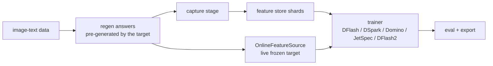

# Online training: live target feature extraction

`train.feature_mode=online` runs the frozen target VLM in the trainer process
and extracts teacher-forced hidden states **live during training**, instead of
reading a pre-captured feature store. The regenerated answers are still
pre-generated: this is not on-policy rollout generation, not continual
learning from live traffic, and not a serving runtime.

```bash
vlm-dflash train --mode online --config configs/qwen2_5_vl_3b.yaml \
  --run-dir runs/qwen25_online
```

`offline` stays the default (presets pin it). `--mode` and `--feature-mode`
are CLI aliases for `train.feature_mode`; the two modes are mutually exclusive
with `--features`.

## Offline vs online

| | offline (default) | online |
| --- | --- | --- |
| Target during training | not loaded | resident for the whole run |
| Feature store on disk | `features/shard_*.pt` + index (2K corpus ≈ 9.4 GiB) | none written |
| Target forward cost | capture stage, once per store | every epoch, per training row |
| `capture` stage | runs | skipped (config still parsed + validated) |
| `train.num_workers` | any | must be 0 |
| Share a capture across algorithms | yes (`--features`) | no |
| Multi-run / multi-node reuse | store is portable | one target, one process |
| Visual-path check | on captured features (`features/visual_path_check.json`) | on the live model (`online/visual_path_check.json`) |

Use **online** when you want a single-command train without managing a feature
store, when disk or IO for a multi-GiB store is the bottleneck, or when the
target should provably be the model the trainer holds. Use **offline** when
several algorithms share one capture, when the target is expensive relative to
the drafter (the cost is paid once, not per epoch), or when you need DataLoader
workers, multi-node training or a portable artifact.

Measured smoke costs on one A6000 (3-row demo slice, 4 steps, batch 1 —
plumbing checks, not benchmarks):

| Target | Target resident | Train peak | Extraction |
| --- | ---: | ---: | ---: |
| Qwen2.5-VL-3B | 7.5 GB | 13.65 GB | 1 forward / 0.30 s (after resume fast-forward) |
| Qwen3-VL-8B (untied head) | 17.5 GB | 33.92 GB | 4 forwards / 2.87 s |

## What is shared with the offline path

The two paths differ only in where the per-sample records come from. (The
README pipeline image, `docs/assets/how-it-works.svg`, draws the offline
staged path; the diagram below adds the live source.)



- `vlm_dflash/target/sample_capture.py` is the shared per-sample capture used
  by both the staged capture stage and the online source: same record fields
  and dtypes (`input_ids`, `hidden`, `loss_mask`, `position3`, `image_span`,
  `sample_id`, optional `final_hidden`), same frozen-head resolution, same
  MRoPE / multimodal-token-type handling.
- The collator, training loop, loss, checkpointing, gradient-coverage audit,
  overfit sanity and calibration phases are the same code for both modes.
- The online source refuses an unfrozen or non-`eval()` target, and resolves
  the same teacher head as the capture stage (`target_lm_head` for untied
  targets, the embedding for tied ones).
- Provenance: `train_summary.json` gains `feature_mode` and a
  `feature_source` block; checkpoints record `feature_mode`,
  `feature_source_digest`, `feature_backend` and both devices;
  `provenance.json` carries the online source record; `eval` records
  `checkpoint_feature_modes`; `export` records `feature_mode`.

## Commands

Single-GPU smoke (small slice, short run):

```bash
vlm-dflash train --mode online --config configs/qwen2_5_vl_3b.yaml \
  --run-dir runs/qwen25_online_smoke --limit 8 --steps 4 \
  --set train.micro_batch_size=1 --set train.grad_accumulation_steps=1 \
  --set train.overfit_sanity.enabled=false
vlm-dflash eval runs/qwen25_online_smoke --num-prompts 4 --max-new-tokens 32
vlm-dflash export runs/qwen25_online_smoke
```

Like the other configs, these commands need prepared inputs: a **local target
checkout** (`--target` / `TARGET.model`), and a single-image JSONL pool with a
100%-valid image dir (`--dataset` / `--images-dir`); see the README *Train on
your data* section and `docs/env-preflight.md`.

Split devices (target on `cuda:1`, drafter on `cuda:0`):

```bash
vlm-dflash train --mode online --config configs/qwen3_vl_8b.yaml \
  --run-dir runs/qwen3vl8b_online \
  --set target.device=cuda:1 --set train.device=cuda:0
```

Resume after an interruption:

```bash
vlm-dflash train --mode online --config configs/qwen2_5_vl_3b.yaml \
  --run-dir runs/qwen25_online --resume
```

A resumed online run fast-forwards already-consumed batches with cheap
placeholders — those rows are **not** re-extracted; the new forward passes are
counted and `train_summary.json` records `resume_fast_forward_batches` and
`resume_fast_forward_reduced_cost`.

## Config requirements

The online source reads the same `capture:` section as the capture stage, so
per-algorithm capture requirements apply unchanged:

- all algorithms: `capture.seq_length`, `capture.dtype` (storage dtype);
- JetSpec: `capture.store_final_hidden: true` **and**
  `drafter.loss_decay_gamma: null`;
- DFlash2: `capture.store_final_hidden: true`.

`doctor` / `validate_config` applies the same fail-loud checks in both modes.
CLI `--set` overrides are merged **before** validation runs, so a required
knob can be supplied either in the YAML or on the command line (e.g. the
JetSpec flags above).

## Boundaries and failure behavior

- `--features <store>` + `--mode online` is refused before any stage runs.
- `train.num_workers` must be 0: the target cannot be copied into a worker.
  Enforced at the CLI level and by the dataset's main-process guard.
- A leftover `features/` store in the same run directory is ignored with a log
  note (run with `--mode offline` to use it).
- `regen/target_data.jsonl` is still required — regen remains the supervision.
- Resume refuses a mode / algorithm / feature-source-digest / step-plan /
  identity mismatch. Checkpoints written before this feature (no
  `feature_mode`) are read as offline.
- `eval` loads the target for verification either way.

## Extraction cost accounting

`train_summary.json` records what the live extraction cost, per phase:

```json
"feature_source": {
  "backend": "huggingface",
  "target_resident_bytes": 7507746816,
  "extractions": {"train": {"target_forwards": 4, "wall_seconds": 2.87}},
  "target_forwards_total": 4,
  "extraction_wall_seconds_total": 2.87,
  "extraction_wall_seconds_note": "..."
}
```

Per-phase counters cover train / overfit sanity / calibration. The startup
visual-path check runs a fixed 3 capture forwards **outside** these counters;
a resumed run does not re-extract fast-forwarded items.

## Validation status

- CPU (dev venv): `tests/test_online_mode.py` (22 tests) plus the full suite
  green.
- GPU smoke 1 — Qwen2.5-VL-3B (`runs/online_smoke_qwen25_3b`, CUDA0, 3-row
  demo slice, 4 steps): train OK; live visual check passed (replay bitwise,
  image span and downstream representations changed on swap); gradient
  coverage 36/36 tensors; eval token-exact; both checkpoints and the export
  record `feature_mode=online`; train peak 13.65 GB.
- GPU smoke 2 — Qwen3-VL-8B untied head (`runs/online_smoke_qwen3_8b`, CUDA1):
  train OK; peak 33.92 GB; target resident 16.33 GiB; eval token-exact;
  export OK.
- GPU smoke 3 — all five algorithms on the same 3B setup (demo slice, 4
  steps, batch 1): DFlash / DSpark / Domino / JetSpec / DFlash2 each ran
  train → eval → export online; train peaks 13.65–15.53 GB; both checkpoints
  token-exact in every run; every checkpoint and export records
  `feature_mode=online`. DSpark's post-training calibration ran on the live
  source (`online_target_head_batches`); JetSpec and DFlash2 ran with
  `capture.store_final_hidden=true` supplied through `--set`.
- Resume check: the 3B run resumed from step 3 → 3 fast-forward batches, 1
  extraction forward (instead of re-extracting 4), reduced cost recorded;
  resumed summary wall 5.4 s.

These smokes validate plumbing (token-exactness, provenance, counters). Their
AL is 1.000 after 4 steps and is **not** a quality result. The recorded
benchmarks in `BENCHMARKS.md` / the Model Zoo are offline-path numbers and
must not be relabelled as online.

## Scope of the first version (v0.3.2)

- Not on-policy: supervision remains the pre-generated regen answers.
- One Hugging Face target, one process; per-sample extraction merged into
  batches by the shared collator (no remote producers, no batched capture
  forward, no multi-node).
- No serving/runtime integration; no continual learning from live traffic.
